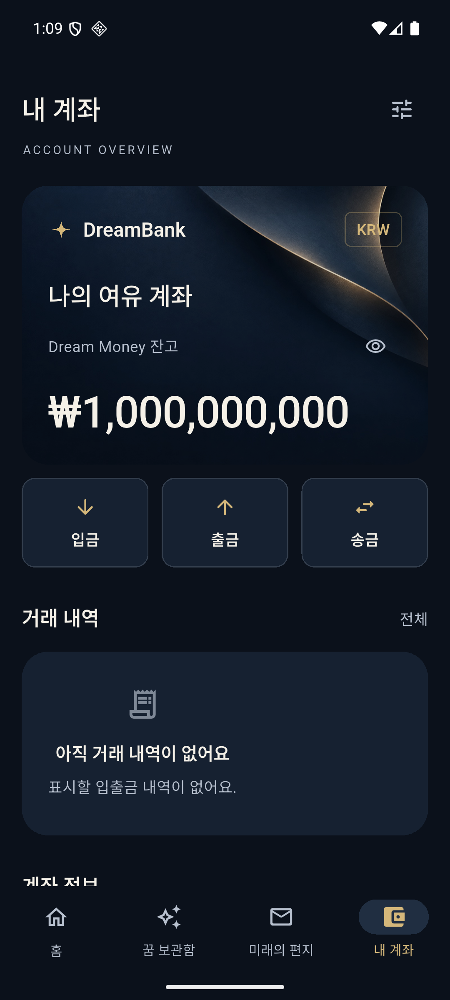
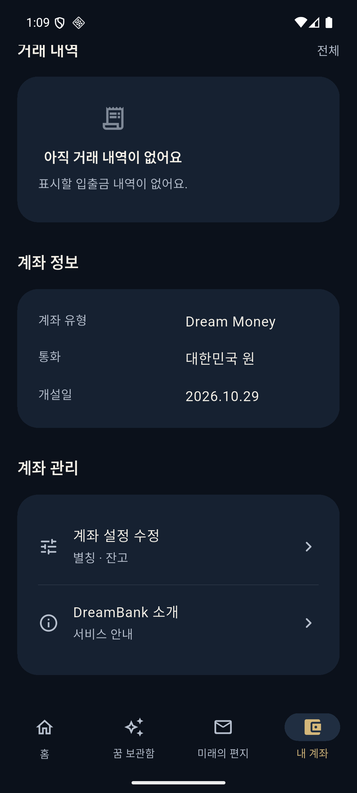

# 내 계좌 상세 UI 고도화

작업일: 2026-10-31 (Asia/Seoul)

## 변경 결과

내 계좌를 모바일 뱅킹의 계좌 상세 구조로 다듬었다.

- 간결한 계좌 헤더와 바로 접근할 수 있는 설정 버튼.
- 브랜드·통화 배지·계좌명·잔고의 명확한 정보 위계.
- 숫자 고정 폭과 자간을 적용한 잔고 표시, 작은 화면의 금액 폭 조정.
- 실제 동작하는 잔고 숨기기·보기 버튼. 숨길 때 금액 위젯과 금액 접근성 라벨을 함께 제거한다.
- 더 조밀한 입금·출금·송금 버튼. 기존 코믹 팝업과 중복 방지 동작 유지.
- 거래 내역 영역과 빈 상태. 존재하지 않는 거래를 채워 넣지 않는다.
- 계좌 유형·통화·개설일 정보. 개설일은 로컬 계좌의 createdAt을 현지 날짜로 표시한다.
- 별칭·잔고 수정 및 서비스 안내를 보조 설명이 있는 관리 메뉴로 구성.

잔고 숨김은 화면 세션 상태이며 계좌 금액을 수정하지 않는다. 홈의 안내와 계좌 수정·저장 동작은 유지했다. DB 스키마·Repository·네트워크 기능은 변경하지 않았다.

## 구현 파일

- `account_screen.dart`: 계좌 상세 섹션과 관리 메뉴, 잔고 표시 상태.
- `account_summary.dart`: 내 계좌 전용 요약과 통화 배지·숨김 버튼.
- `account_balance.dart`: 공통 금액 표시·고정 폭 숫자·화면 폭 대응·접근성 라벨.
- `account_card.dart`: 홈에서도 공통 금액 위젯 사용.
- `account_actions.dart`: 버튼 밀도·색상 조정, 기존 팝업 유지.
- `test/widget/account_actions_test.dart`: 잔고 숨김·복원과 실제 개설일 검증 추가.

파일 경로의 기준은 `lib/features/account/presentation/`이다.

## 검증

| 항목 | 결과 |
|---|---|
| 정적 분석 | No issues found |
| 전체 단위·위젯 테스트 | 40개 통과 |
| 큰 글자·작은 화면 | 기존 폭 320·430·800 및 글자 배율 1.0·1.3·2.0 검증 포함 |
| 계좌 동작 | 잔고 숨김·복원, 실제 날짜, 팝업·데이터 불변성, 계좌 수정 회귀 통과 |
| Android debug 빌드 | 성공 |
| iOS 시뮬레이터 debug 빌드 | 성공 |
| 실제 화면 확인 | Android 에뮬레이터에서 상단 계좌와 하단 정보 확인 |

검증 로그는 [account-detail-evidence](account-detail-evidence/tests.txt)에 보관했다. iOS는 빌드 검증이며 이번 작업의 실기기·스토어 배포 검증은 수행하지 않았다.

- [정적 분석](account-detail-evidence/analyze.txt)
- [Android 빌드](account-detail-evidence/android-build.txt)
- [iOS 빌드](account-detail-evidence/ios-build.txt)

최종 빈 상태 중앙 정렬 보완 후 빌드·테스트를 다시 통과했다. 마지막 에뮬레이터 재설치는 사용자 승인 거절로 수행하지 않았다. 아래 화면은 정렬 보완 직전의 실행 캡처이며, 최신 APK는 `build/app/outputs/flutter-apk/app-debug.apk`에 있다.

## 실행 화면

