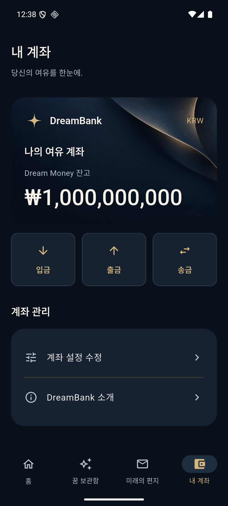
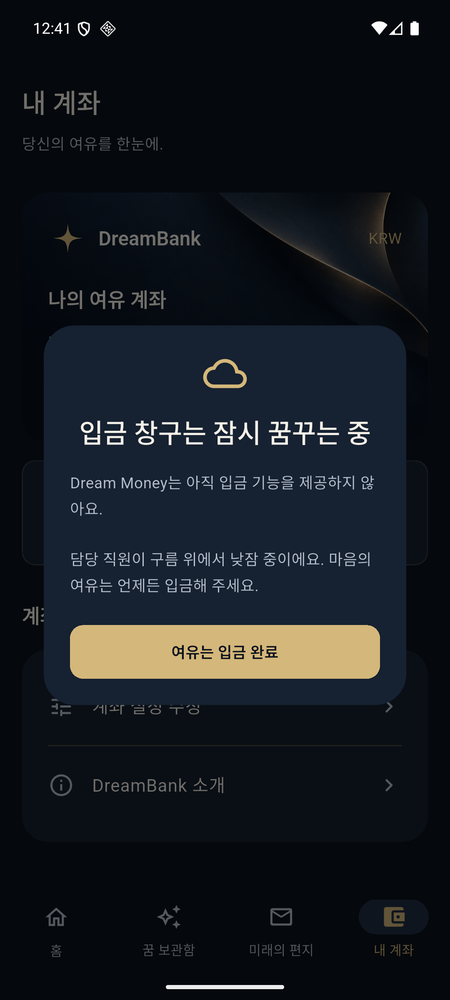

# DreamBank 내 계좌 개편 결과

기준: [내 계좌 개편 프롬프트](account-redesign-prompt.md)

## 구현 내용

내 계좌를 계좌 요약 → 주요 금융 동작 → 계좌 관리 순서로 개편했다. 기존 네이비·골드 이미지 카드에 DreamBank 로고, KRW, 계좌 별칭, Dream Money 잔고와 큰 금액을 표시한다.

- 내 계좌에서 경고성 문구를 숨겼다. 공통 `AccountCard`에 `showDisclosure` 옵션을 추가하고 기본값은 true로 유지했다. 홈의 가상 잔고 안내와 앱 소개는 유지된다.
- 카드 아래에 같은 중요도의 입금·출금·송금 버튼을 추가했다. 아이콘과 라벨을 함께 제공하고 큰 글자에서는 세로 배치한다.
- 버튼별로 프롬프트의 제목·본문·확인 문구를 가진 코믹 팝업을 표시한다.
- 팝업은 확인 버튼, 바깥 영역 탭, 시스템 뒤로가기로 닫을 수 있다. 반복 요청에는 하나만 열고 닫은 후 다시 이용할 수 있다.
- 작은 화면과 큰 글자에서는 팝업을 스크롤해 전체 내용을 읽을 수 있다.
- 계좌 설정 수정과 DreamBank 소개를 관리 목록으로 정리했다. 구현되지 않은 공유 기능의 진입점은 추가하지 않았다.

입출금·송금 버튼은 Presentation 계층의 안내 동작이다. Repository·네트워크·결제 기능에 연결하지 않았으며 잔고나 거래 데이터를 바꾸지 않는다. 허위 계좌번호·거래 내역·인증 표시를 추가하지 않았다.

## 변경 파일

| 파일 | 역할 |
|---|---|
| `lib/features/account/presentation/account_card.dart` | 화면별 안내 정책, 계좌 브랜드·KRW·잔고 명칭 |
| `lib/features/account/presentation/account_screen.dart` | 계좌 요약·동작·관리 영역 |
| `lib/features/account/presentation/account_actions.dart` | 세 동작 enum, 반응형 버튼, 공통 팝업과 중복 방지 |
| `test/widget/account_actions_test.dart` | 팝업 동작·데이터 불변성·작은 화면 검증 |

추가 패키지나 DB 스키마 변경은 없다.

## 검증 결과

| 검사 | 실제 결과 |
|---|---|
| 정적 분석 | No issues found |
| 전체 단위·위젯 테스트 | **40개 통과** |
| Android debug 빌드 | APK 생성 성공 |
| iOS 시뮬레이터 debug 빌드 | Runner.app 생성 성공 |
| Android 실제 실행 | 내 계좌와 입금 팝업 렌더링·시스템 뒤로가기 확인 |

추가한 테스트에서 다음을 검증했다.

1. 내 계좌에는 경고성 문구가 없고 홈에는 기존 안내가 유지된다.
2. 저장된 별칭·잔고와 KRW를 표시한다.
3. 세 버튼이 각각 정해진 제목·안내·확인 문구를 표시한다.
4. 확인 버튼·바깥 영역·시스템 뒤로가기로 팝업을 닫고 다시 열 수 있다.
5. 빠른 반복 요청이 겹쳐도 팝업은 한 개만 열린다.
6. 실제 테스트 DB의 계좌·마음·꿈·편지 및 안내 설정을 실행 전후 비교했을 때 동일하다.
7. 폭 320·글자 배율 2.0에서 세 버튼·팝업·관리 영역에 접근할 수 있다.
8. 기존 계좌 수정·홈 반영·탭 이동·저장소·이미지 테스트도 통과한다.

iOS는 이번 변경의 시뮬레이터 빌드까지 검증했다. iOS 팝업의 별도 네이티브 UI 자동화, 실기기·릴리스·스토어 배포 검증은 수행하지 않았다. 위젯 테스트의 팝업 검증과 플랫폼 빌드 결과를 구분한다.

## 검증 기록

- [정적 분석](account-redesign-evidence/analyze.txt)
- [전체 테스트](account-redesign-evidence/tests.txt)
- [Android 빌드](account-redesign-evidence/android-build.txt)
- [iOS 빌드](account-redesign-evidence/ios-build.txt)

재현 명령:

```sh
sh scripts/flutterw analyze
sh scripts/flutterw test
sh scripts/flutterw build apk --debug
sh scripts/flutterw build ios --simulator --debug
```

## 실제 화면

### 내 계좌



### 입금 팝업


