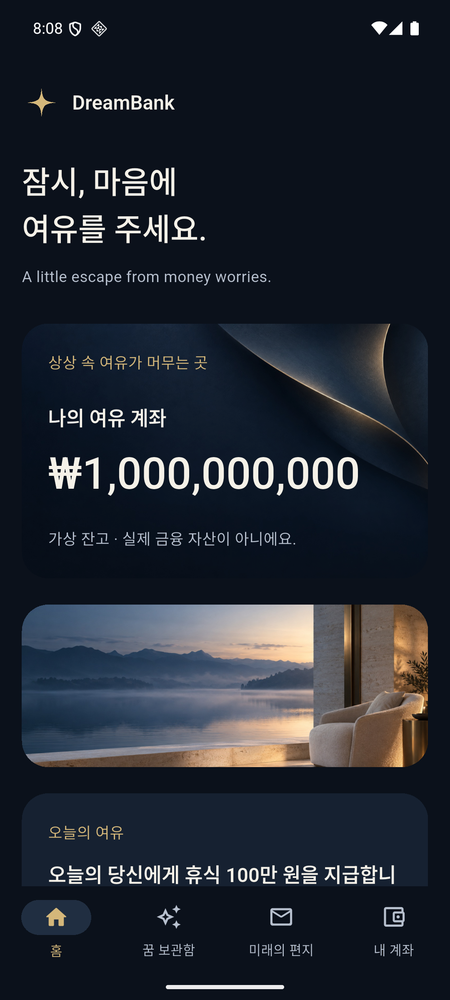
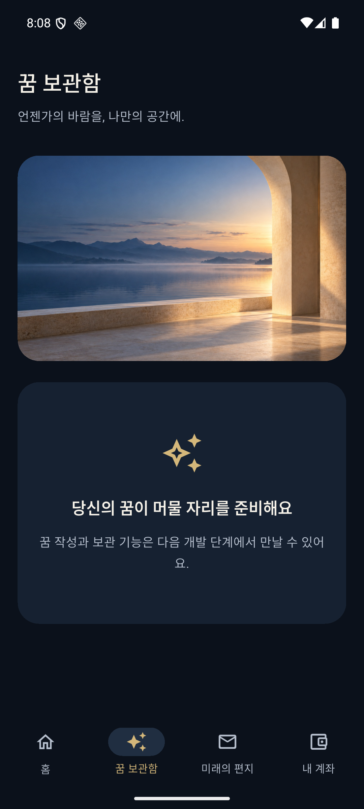
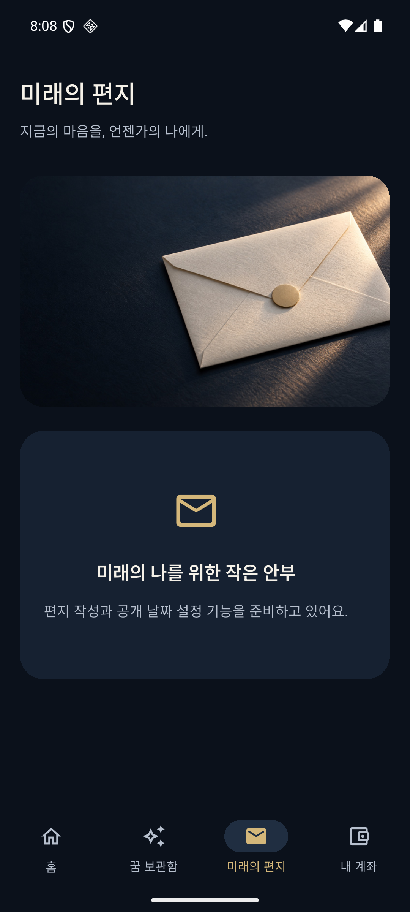
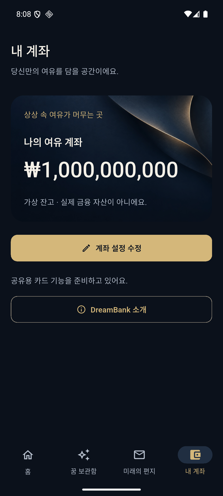
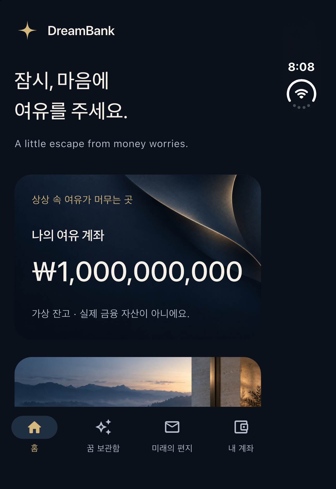

# DreamBank 이미지 적용 결과

작업일: 2026-10-30 (Asia/Seoul)

## 적용 내용

생성한 아이콘·로고·계좌 배경·홈·꿈·편지 이미지를 앱에 적용했다. 생성된 PNG 원본 6개는 그대로 보관했다.

| 대상 | 적용 방식 |
|---|---|
| Android·iOS 앱 아이콘 | `app_icon_master.png`에서 플랫폼별 PNG 20개 파일 내보내기 |
| 화면 로고 | `dreambank_symbol.svg`와 동일한 곡선 좌표를 Flutter CustomPainter에 적용 |
| 홈·내 계좌 카드 | `account_card_background.jpg`, 둥근 클리핑과 약한 네이비 오버레이 |
| 홈 | 계좌 아래에 `home_serenity.jpg`를 낮은 가로 배너로 배치 |
| 꿈 보관함 | 소개 제목 아래에 `dream_vault.jpg` 배치 |
| 미래의 편지 | 소개 제목 아래에 `future_letter.jpg` 배치 |

금액·별칭·메시지·가상 잔고 표시는 이미지와 분리된 실제 앱 텍스트다. 홈의 계좌 카드를 사진보다 먼저 배치해 잔고의 우선순위를 유지했다. 꿈·편지의 CRUD와 카드 공유 기능은 이번 이미지 적용에서 추가하지 않았다.

작은 화면의 로고는 생성 심벌의 평면 벡터 정리본을 사용한다. 투명 PNG 심벌은 원본·참고용으로 보관하며, SVG와 동일한 Path를 사용하므로 SVG 렌더링용 패키지를 추가하지 않았다.

## 자산과 최적화

- 앱에 등록한 사진·배경: `assets/images/`의 JPEG 4개, 총 **1,076,210 bytes**.
- 대응 원본 PNG 4개: 총 **8,449,105 bytes**. 원본 대비 약 87% 축소했다.
- 원본 PNG·아이콘 마스터·참고용 심벌은 Flutter 자산 번들에 중복 포함하지 않았다.
- 사진과 배경은 전부 로컬 파일이므로 이미지용 네트워크 연결이 필요 없다.
- 장식 이미지의 접근성 읽기를 제외하고 실제 정보는 텍스트로 제공한다.
- 이미지 비율을 예약해 로딩 시 레이아웃 이동을 줄였다. 표시용 디코딩 폭은 1200으로 제한했다.
- 장식 자산을 읽지 못하면 기본 surface 색으로 복구하며 핵심 정보를 유지한다.

새 패키지는 추가하지 않았다. 현재 도구에서 WebP 내보내기를 바로 사용할 수 없어 macOS ImageIO의 JPEG 내보내기를 사용했다. 실제 화면에서 소재와 빛의 품질을 확인했다.

재현 명령:

```sh
python3 scripts/prepare_image_assets.py
python3 scripts/generate_app_icons.py
sh scripts/flutterw pub get
```

두 스크립트는 macOS의 `/usr/bin/sips`를 사용한다. 새 AI 이미지를 생성하는 스크립트가 아니라 기존 마스터의 포맷·크기를 플랫폼에 맞추는 내보내기 도구다.

## 주요 변경 파일

- `pubspec.yaml`: 실제 사용하는 JPEG 4개 등록.
- `lib/core/constants/app_assets.dart`: 자산 경로 상수.
- `lib/core/widgets/editorial_image.dart`: 비율·클리핑·디코딩·실패 대체 처리.
- `lib/core/widgets/app_card.dart`: 선택적인 이미지 배경과 가독성 오버레이.
- `lib/core/widgets/brand_mark.dart`: 새 곡선 별 심벌.
- `lib/features/account/presentation/account_card.dart`: 공통 계좌 카드 배경 연결.
- 홈·꿈·편지 presentation 파일: 해당 페이지 사진 배치.
- Android mipmap 및 iOS AppIcon 카탈로그: 새 아이콘 파일.
- `scripts/prepare_image_assets.py`, `scripts/generate_app_icons.py`: 재현 가능한 내보내기.

## 검증 결과

| 항목 | 실제 결과 |
|---|---|
| 정적 분석 | No issues found |
| 전체 단위·위젯 테스트 | **37개 통과** |
| 이미지 번들·디코딩 | JPEG 4개를 실제 asset bundle에서 읽고 이미지 codec으로 디코딩 성공 |
| 작은 화면·글자 확대 | 기존 폭 320·430·800, 배율 1.0·1.3·2.0 검증 포함 |
| 기존 P0 기능 | 잔고·마음·계좌 편집·오류 복구·안내·탭·스크롤 테스트 회귀 통과 |
| Android debug 빌드 | APK 생성 성공 |
| iOS 시뮬레이터 debug 빌드 | Runner.app 생성 성공 |
| 실제 실행 | Android 에뮬레이터와 iOS 시뮬레이터에서 홈 렌더링 확인 |
| 페이지 시각 확인 | Android 홈·꿈·편지·내 계좌 확인 |
| 원본 보존 | 생성 원본 6개의 SHA-256이 기존 manifest와 일치 |

Android 빌드에 기존 SDK XML 버전 경고가 있었으나 빌드와 앱 실행은 성공했다. 실기기·릴리스·스토어 배포 검증은 수행하지 않았다. 이번 작업에서 native 통합 테스트는 다시 실행하지 않았으며, 기존 P0 회귀와 자산 검증은 위 37개 테스트에 포함된다.

- [분석 로그](artwork-evidence/analyze.txt)
- [테스트 로그](artwork-evidence/tests.txt)
- [Android 빌드](artwork-evidence/android-build.txt)
- [iOS 빌드](artwork-evidence/ios-build.txt)

## 적용 화면

### Android 홈



### Android 꿈 보관함



### Android 미래의 편지



### Android 내 계좌



### iOS 홈


