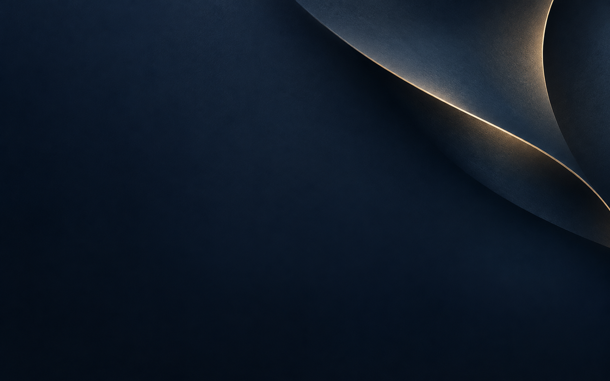

# DreamBank 생성 이미지 리소스

제작일: 2026-10-30 (Asia/Seoul)

[이미지 생성 프롬프트](image-generation-prompts.md)의 필수 01~06을 built-in image_gen 도구로 각각 생성했다. 이미지 생성에는 [imagegen 스킬](/Users/peter/.codex/skills/.system/imagegen/SKILL.md)을 사용했다. CLI/API 방식은 사용하지 않았다.

## 저장 파일

| 리소스 | 파일 | 실제 크기 | 용도 |
|---|---|---|---|
| 앱 아이콘 원본 | [app_icon_master.png](../assets/brand/app_icon_master.png) | 1254×1254 | 플랫폼별 런처 아이콘 제작용 마스터 |
| 투명 심벌 | [dreambank_symbol.png](../assets/brand/dreambank_symbol.png) | 1254×1254 | 생성된 로고 원본·시각적 참고 |
| 단색 벡터 심벌 | [dreambank_symbol.svg](../assets/brand/dreambank_symbol.svg) | 1024 viewBox | 작은 헤더·카드 로고용 평면 벡터 정리본 |
| 계좌 카드 배경 | [account_card_background.png](../assets/images/originals/account_card_background.png) | 1586×992 | 잔고와 별칭을 별도 렌더링하는 배경 |
| 홈 라운지 | [home_serenity.png](../assets/images/originals/home_serenity.png) | 1536×1024 | 호수와 새벽빛이 있는 프라이빗 라운지 |
| 꿈 보관함 | [dream_vault.png](../assets/images/originals/dream_vault.png) | 1536×1024 | 수평선으로 열린 아치 공간 |
| 미래의 편지 | [future_letter.png](../assets/images/originals/future_letter.png) | 1536×1024 | 네이비 표면 위 아이보리 봉투·골드 봉인 |

PNG는 생성 원본 크기로 보관했다. 문서의 1024px 아이콘과 1600×1000 카드 크기는 최종 내보내기 목표이며, 현재 파일 크기는 위 표와 같다. SVG는 생성된 별의 형태를 참고해 곡선으로 정리한 별도 단색 벡터이며 PNG를 자동 추적한 결과는 아니다.

선택 항목 07의 안내용 오브젝트는 필수 이미지와 중복되는 용도여서 이번에는 제작하지 않았다. DreamBank 워드마크와 잔고·별칭·공개 날짜·가상 표시는 앱 텍스트로 유지한다.

## 제작 및 검증

- 아이콘의 별 형태를 참고해 투명 심벌을 생성했다.
- 홈 라운지 이미지를 색감·소재·조명 참고로 사용해 꿈과 편지 이미지를 생성했다.
- 금액·계좌번호·워터마크·기존 금융사 로고가 이미지에 포함되지 않았는지 시각적으로 확인했다.
- 계좌 카드의 좌측과 하단에 정보 배치 여백이 있는지 확인했다.
- 6개 PNG의 헤더·청크 CRC·압축 픽셀 스트림 길이를 검증했다.
- 심벌 PNG에서 알파 값 0~255를 확인해 실제 투명 영역과 불투명 심벌이 있음을 검증했다.
- [파일 정보와 SHA-256](../assets/image-manifest.json), [실제 사용 프롬프트와 참고 이미지](image-generation-record.json)를 보관했다.

## 앱 적용 시

이미지 생성 후 앱 적용을 완료했다. Flutter 자산 등록과 화면·런처 아이콘 적용 및 검증 결과는 [이미지 적용 결과](artwork-integration-report.md)를 따른다. 아래 원본 PNG는 그대로 보관하며, 실제 화면은 최적화한 JPEG를 사용한다.

장면과 카드 배경은 현재 JPEG로 내보냈고, 아이콘은 생성 원본에서 플랫폼별 크기로 변환했다. 원본 PNG는 보존한다. 카드 배경에는 Flutter의 계좌 데이터와 가상 잔고 표시를 별도로 올리고, 작은 심벌은 단색 벡터를 우선한다. 실제 위젯 위에서 긴 별칭·최대 금액·큰 글자·작은 화면의 가독성을 확인한다.

## 미리보기

### 계좌 카드 배경

### 홈

### 꿈 보관함

### 미래의 편지

